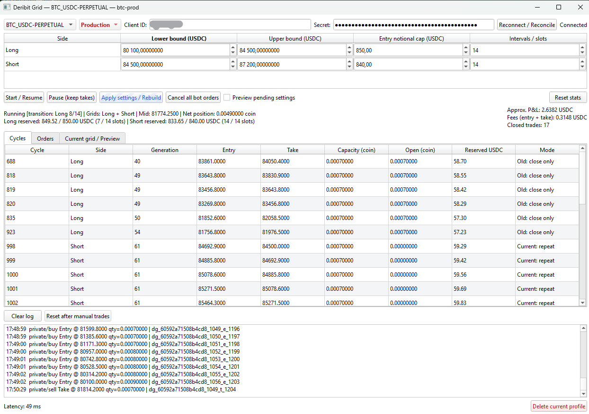
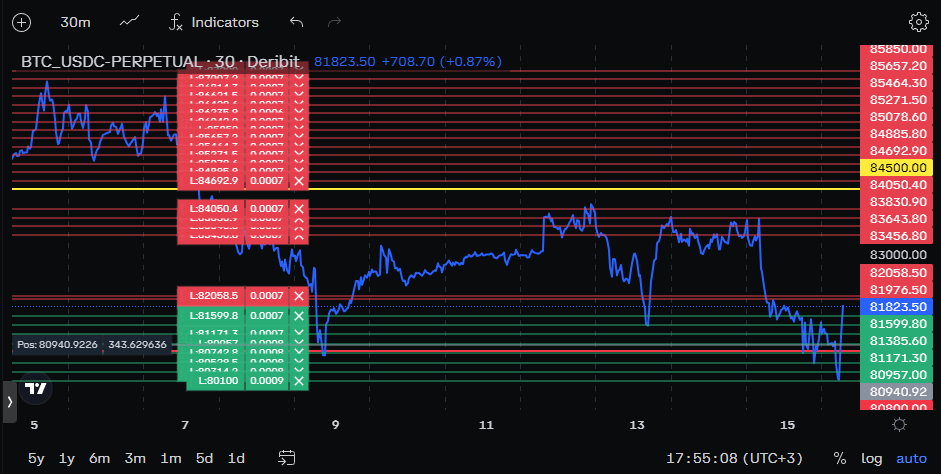

**Deribit Grid**

Windows x64 grid bot for **BTC/ETH USDC perpetuals**, built with C++20 and Qt 6.
Independent Long/Short grids, automatic price following, SQLite recovery, and local PnL/fee counters.

**Run**

1. Download the **Windows x64 ZIP** from this repository's **Releases** page.
2. Extract the **entire ZIP** to a writable folder, then double-click **start.cmd**.
3. Select BTC or ETH and **Testnet**, then click **Open**.
4. Enter your Testnet Client ID/secret and click **Connect**.
5. Set each side's range, entry-notional budget in USDC, and interval count; click **Start / Resume**.

No Python, Qt installation, or build tools are needed to run the ZIP. 
Keep its EXE, DLLs, plugins, and launcher together. Launch again for the other instrument.

**Behavior**

- A zero budget disables a side. Ranges must not overlap. Takes use the adjacent grid level.
- **Apply settings / Rebuild** preserves existing positions/takes and rebuilds changed sides.
- **Pause (keep takes)** cancels entries; **Cancel all bot orders** also removes takes. Neither closes positions.
- Profiles are saved beside the EXE in `profiles/`, separately for each instrument/environment. They connect your inventory to its takes. 
- API secrets are kept in local memory only.
- Reconnects reconcile orders and positions before resuming. A new application run starts paused.
  Accepted orders remain on the exchange during a disconnect; new fills cannot receive takes while offline. You can turn Auto CoD (cancel on disconnect) on when setting API key up on Deribit, then all orders will be cancelled once a disconnect happens.
- **Approx. P&L** uses grid entry/take prices and filled quantity, excluding fees and funding.
  **Fees** uses actual entry/take commissions, including rebates; missing data is marked incomplete.
  Partial take fills count immediately; a filled take counts as one closed trade.
  Counters reset on exit or **Reset stats**; missed fills are included during recovery. Overnight or orders completed while the bot was turned off will be counted next time you connect the bot to Deribit.

There are no stop-losses; the bot was designed for use with options. Production trades real funds, and testnet is simulated.

**Bot in work**



**Performance**

Reference local Release benchmarks, Qt 6.8.3, 14 October 2026; 14+14/20+20 means intervals per side.

| Operation | Time |
| --- | ---: |
| Long shift preparation, 14+14 | 1.627 microseconds |
| Long shift preparation, 20+20 | 1.897 microseconds |
| Tick handling + UI update, 14+14 | 0.118 ms |
| Tick handling + UI update with preview, 20+20 | 0.173 ms |
| Event + durable SQLite save | 12.81 ms |

These measure local processing: shift preparation excludes network requests; UI updates exclude
pixel painting. Results depend on the machine and workload and do not measure order execution.

**Order pacing:** `MinimumTradingIntervalMs = 500` in `src/exchange/client.h` spaces creates,
edits, and cancellations by at least 500 ms: at most **2 trading requests/second per window**.

Account limits can slow this further. All RPCs are spaced by at least 100 ms; trading requests
also wait for the preceding response. `InitialRetryMs = 1500` is the initial reconnect delay,
with disconnect backoff up to 30 seconds.

**Build from source**

Requires Visual Studio 2022 C++ x64/CMake tools, Python 3, and Qt 6.8+ MSVC x64 with WebSockets.

```powershell
python scripts/dependencies.py
python scripts/build.py --qt C:/Qt/6.8.3/msvc2022_64
```

Then run `start.cmd`. Build details and portable packaging: [docs/BUILDING.md](docs/BUILDING.md).

**License**

[MIT](LICENSE) — nieledran (Dan Rosenberg d. R.). Dependencies retain their own
licenses; see [THIRD_PARTY.md](THIRD_PARTY.md) and [licenses/](licenses/).

> [!CAUTION]
> This codebase was fully AI-written, model: GPT 6.1 sol (high).
